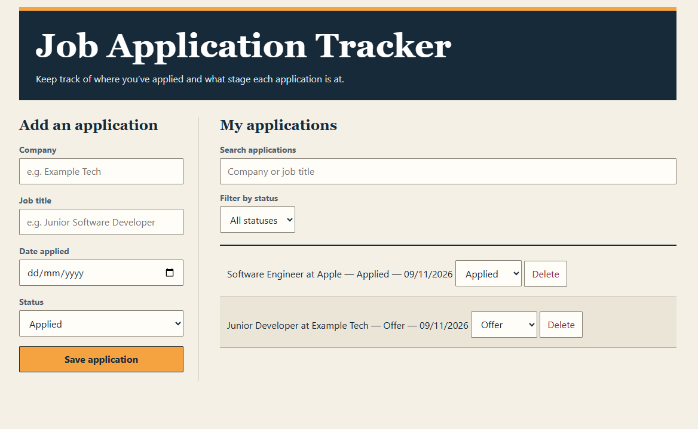

# Job Application Tracker

A full-stack app for tracking job applications from Applied through Interview, Offer, or Rejected. It uses HTML, CSS, and JavaScript on the frontend, with a Python API and SQLite database.

## Features

- Log the company, job title, date applied, and status.
- Search by company or job title and filter by status at the same time.
- Update the status of an existing application.
- Delete applications with a confirmation prompt.
- Save applications in SQLite so they survive page refreshes and server restarts.

## Screenshot



## Run locally

1. Clone or download the repository.
2. From the project folder, run:

   ```bash
   python3 server.py
   ```

3. Open [http://localhost:8000](http://localhost:8000).

The server creates `applications.db` on first run. Git ignores that file so your application data stays out of the repository.

## Try it out

Add a sample application, change its status to Interview, and select Interview in the filter. Refresh the page to verify the status was saved, then delete the sample entry.